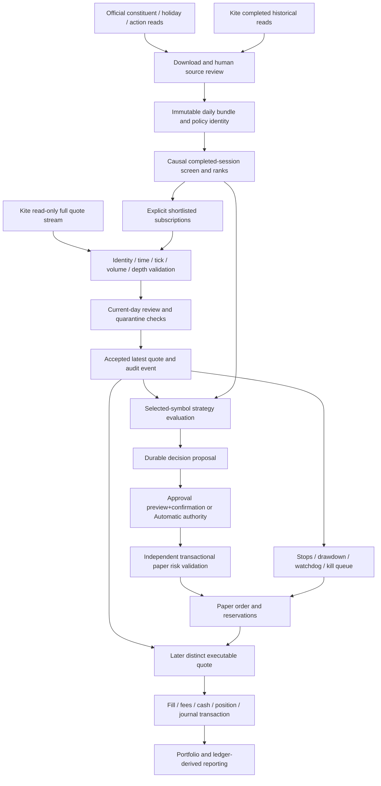

# Architecture audit — Agentic Trader V2, Phase 1

Audit date: **22 October 2026 (IST)**. Baseline: **0.14.0**, Git HEAD
`2d5c208` (`feat: add market analysis page with interactive charting and data display`).
The baseline already includes the light workspace, analysis page and viewport-aware
confirmation changes; these are existing implementation, not changes made by this audit.
The initial working tree had only untracked `improvements.txt`.

This is the Phase 1 inspection requested by `improvements.txt`. No application code,
account records, credentials, decisions, modes or broker sessions were changed. No
broker requests, server restarts or real orders were performed. Findings distinguish
observed code behavior, reproducible local defects, design constraints and work that
has not been implemented. References use baseline file and line numbers; later edits
may move them.

## 1. Assessment

The application is a substantial **single-user, local paper-trading modular monolith**,
not an unfinished collection of placeholder buttons. Its strongest parts are the
independent paper execution boundary, exact accounting, durable journal, conservative
recovery, causal research inputs and explicit operator authority. Those components
should be preserved.

The complete requested long-term investment product does not yet exist. Current
stock discovery is a price/turnover/volatility screen, connected execution is limited
to ten saved instruments, and the strategy is a short holding-period hypothesis.
Fundamentals, portfolio construction, benchmark analytics, broader long-term strategy
configuration and an integrated backtesting UI are missing or partial. A light theme
and charts do not establish strategy validity, external data acceptance or profitability.

A confirmed early-year calendar bootstrap defect and several integration/reliability
risks warrant work before adding a larger strategy interface. No real-money execution
path was found in the inspected implementation; the system deliberately prevents one.

## 2. Technology and deployment inventory

| Layer | Actual implementation | Evidence / limits |
|---|---|---|
| Runtime and package | Python `>=3.13,<3.14`, Hatchling package, `trading-agent` CLI, version 0.14.0 | `pyproject.toml:1`, `pyproject.toml:5`, `pyproject.toml:19`; `uv.lock` provides the reproducible dependency resolution. |
| HTTP service | FastAPI, Pydantic v2 validation, Uvicorn; synchronous handlers use its worker pool, setup explicitly uses `run_in_threadpool` | `api/app.py:27`, `api/setup.py:511`; no external application server or task queue. |
| Frontend | Locally served HTML/CSS and vanilla JavaScript controllers; same-origin iframe sections within a sidebar workspace; SVG candles/averages | `api/static/workspace.html:1`, `workspace.js`, `workspace-bridge.js:1`, `analysis.js`; no React/Vue framework or separate build service. |
| Persistence | SQLite, WAL, full synchronous writes, foreign keys, one owning process and reentrant in-process locks | `persistence/database.py:91`, `:108`, `:154`; one Uvicorn worker (`main.py:608`). |
| Broker connectivity | Optional `httpx` and `websockets`; restricted official Kite HTTP routes and full-mode WebSocket decoder | `broker/readonly_kite.py:50`, `:328`, `:393`; market reads/authentication only. |
| Financial arithmetic | Python `Decimal`, stored as decimal strings; integer share quantities; conservative tick rounding and versioned estimated fees | `execution/costs.py:11`, `risk/limits.py:9`, `persistence/database.py:30`; chart geometry uses approximate numeric coordinates while exact values remain available. |
| Research / optional ML | Pure Python causal screening, replay and runtime inference; optional NumPy/scikit-learn for training | `daily_research/analysis.py:116`, `daily_execution/runner.py`, `ml/training.py`, `ml/inference.py`; no generic model service. |
| Configuration | Frozen validated TOML settings plus environment-only secrets/path/mode overrides; server-owned per-account analysis and credential files | `settings.py:13`, `:77`; `api/setup.py:54`; UI cannot provide arbitrary local source paths. |
| Operations and QA | Local shell launchers, optional service scripts, JSON rotating logs, preflight, backup/report CLI, pytest, Node test runner, Ruff, mypy, secret/dependency checks and benchmarks | `scripts/`, `.github/workflows/ci.yml:1`, `observability/`; macOS/Linux assumptions include `fcntl.flock`, so Windows support is not established. |

The present ten-instrument stream ceiling is an **application policy**, not a finding
about the broker's maximum subscription capacity (`settings.py:66`,
`broker/readonly_kite.py:404`). Default capital is ₹25,000, trade risk ₹62.50, daily loss
budget ₹250, two positions and ₹20,000 total notional (`settings.py:21`). These are
pilot assumptions, not investment recommendations. Financial policy changes are
bound to the existing account fingerprint and may require a new account rather than
an in-place change (`execution/paper_broker.py:75`).

## 3. Ownership and module map

Paths below are under `src/trading_agent/` unless stated otherwise.

| Component | Responsibility and integration |
|---|---|
| `main.py` | CLI parsing, explicit engine creation, manual/supervised startup, reporting and shutdown. `open_engine` creates the calendar, database and paper broker (`:38`); service wiring is at `:565`. |
| `api/app.py` | Composition root for HTTP: authentication, security headers, lifespan/watchdog, setup/desk/analysis mounting, manual paper intents, portfolio actions and safety controls (`:27`, `:64`, `:145`, `:268`, `:347`). |
| `api/setup.py` | Saves private broker credentials, exchanges manually acquired request tokens, verifies profile, validates catalog/selection/calendar, creates/replaces the read-only feed and stores completed stream candles (`:54`, `:173`, `:242`, `:269`, `:377`). |
| `broker/readonly_kite.py` | Fixed-host HTTP transport, paced historical reads, raw daily/minute acquisition, packet validation, transport diagnostics and bounded consecutive reconnect failures (`:28`, `:50`, `:259`, `:438`). |
| `market_data/` | Reviewed explicit exchange calendar, 1m/5m candle builders and candle repository. Calendar decisions use IST; timestamps normalize to UTC (`calendar.py`, `candles.py`, `repository.py`). |
| `daily_research/` | Validated manifest, known-at universe membership, raw daily bars plus explicit period benefits, causal price/turnover/volatility screening and standalone read-only research reports (`dataset.py:46`, `:126`; `analysis.py:116`). |
| `desk/sources.py`, `desk/preparation.py`, `desk/guided.py` | Official constituent/calendar/action acquisition, cancellable durable download jobs, reviewed strategy installation and explicit preview/confirm orchestration. Multi-step effects are recorded, not treated as one reversible financial transaction (`guided.py:291`). |
| `desk/research.py` | Loads immutable reviewed profile/data/model identities, refreshes broad research off the execution lock, and caches selected timelines (`:18`, `:71`, `:79`). |
| `desk/signals.py` | Background selected-symbol strategy evaluation. Daily signals use prior completed sessions plus current usable quotes; intraday historical acquisition remains a separate legacy path (`:81`, `:107`, `:200`). |
| `desk/service.py`, `desk/accounting.py` | Manual/Approval/Automatic authority, durable proposals, revalidated preview and authorization, shortlist binding, pause/cancel policy and journal/materialization reconciliation (`service.py:194`, `:303`, `:547`, `:582`; `accounting.py:31`). |
| `execution/paper_broker.py` | Central independent risk admission, cash/risk reservation, immutable intent identity, simulated orders, later-quote fills, stops/targets, emergency exit queue and exact account snapshots (`:291`, `:379`, `:558`, `:693`, `:791`, `:851`). |
| `risk/`, `execution/costs.py` | Pure bounded share sizing, tick rounding and estimated cash/risk/reward including transaction costs; called while resources are transactionally reserved (`risk/limits.py:9`). |
| `execution/long_term.py`, `execution/delivery.py` | Overnight policy, current-day price-basis reviews, session pinning, drawdown checkpoints, corporate-action quarantine and delivery fee/review reconstruction (`long_term.py:20`, `:94`, `:158`; `delivery.py:36`). |
| `corporate_actions/` | Explicit offline reviewed split/bonus/dividend entitlements, nonspendable receivables/fractional claims, actual paper cash-receipt events and independent ledger reconstruction (`service.py:97`, `:226`; `accounting.py`). |
| `portfolio/` | Bounded explicit top-ups and SIP plans/occurrences using the same broker, approvals and accounting. SIP is a reviewed paper-purchase workflow, not an unattended portfolio optimizer (`service.py:191`, `accounting.py:23`). |
| `backtesting/`, `daily_execution/` | Isolated causal replay with observed later quotes, fee/depth/slippage assumptions, daily delivery timelines/actions, artifacts and incomplete-result gates. No invented execution path from daily OHLC (`backtesting/runner.py:211`, `daily_execution/runner.py:252`). |
| `ml/` | Separate labels, purged chronological train/calibration/holdout windows, bounded JSON coefficient artifacts, identity/availability validation and an independent execution gate; no pickle model loading. |
| `paper/runtime.py`, `paper/service.py` | Existing supervised intraday controller, history worker, disarm/recovery and telemetry. This is not the main long-term research architecture; preserve it without feature expansion during modernization. |
| `api/analysis.py` | Read-only bounded chart response for installed daily data or saved 1m/5m candles, SMA20/50 and independent quote usability. It neither downloads nor refreshes the strategy nor grants authority (`:69`, `:246`). |
| `desk/activity.py`, `paper/*report.py`, `backtesting/report.py` | Separate proposal/order/fill views, bounded order/fill pagination and ledger-derived reports. Trade P&L and investment income are explicitly separated. |

## 4. End-to-end data and decision trace

1. **Acquire research inputs.** The UI can request Nifty100/500 constituents, an NSE
   holiday proposal and corporate-action page data through fixed URLs. Preparation
   matches supported equity identifiers to the catalog, excludes returned actions and
   incomplete history, reads up to 60 completed daily sessions, stores raw responses
   and hashes, and publishes a reviewable draft (`desk/sources.py:12`,
   `desk/preparation.py:275`). Current constituents remain a prospective snapshot,
   not reconstructed historical membership.
2. **Review and install.** Operator acknowledgements bind source, calendar, basis and
   policy. Guided preview includes account/catalog/selection/holdings/cash/order and
   review evidence, expires after two minutes, then confirms disconnect → install →
   select → listed daily reviews → feed request. Earlier saved phases remain visible
   after a failure. The account stays Manual (`desk/guided.py:225`, `:275`, `:291`).
   This acknowledgement is human review authority, not independent verification of
   exchange data completeness or corporate-action treatment.
3. **Receive and validate quotes.** Full equity packets require known tokens and
   nonempty top bid/ask depth. Empty-sided observations invalidate that symbol's
   executable quote without pretending the socket is disconnected
   (`broker/readonly_kite.py:328`, `:362`; `api/setup.py:422`). The paper broker checks
   tick grid, ordering, volume regression, receipt age and long-term basis before
   accepting the quote (`execution/paper_broker.py:693`). A connected feed alone
   confers no readiness.
4. **Respect precise clock semantics.** Exchange/receipt times must be aware; current
   usable quote age is checked independently. Identical same-time observations do
   not renew freshness. Changed whole-second Kite updates may advance by strictly
   later receipt order without creating another fill budget; replay remains strict
   (`models.py:54`, `execution/paper_broker.py:709`, `:779`). Stream candles are saved
   separately and missing/unknown-volume intervals retain quality flags.
5. **Screen and evaluate.** Daily windows calculate explicit gross analytical return,
   trend, volatility and approximate turnover; candidate ranks sort by return with
   deterministic symbol ties (`daily_research/analysis.py:82`, `:201`). The background
   worker refreshes broad research every 60 seconds outside the execution lock,
   then uses selected-symbol timelines and fresh quotes for daily eligibility/gap and
   holding-exit decisions (`desk/signals.py:81`, `:107`). No fundamentals or probability
   of future profit is supplied by this rank.
6. **Separate signal from authority.** A durable identity binds profile, symbol, side,
   IST date and signal key; mode changes do not create a new daily signal
   (`desk/service.py:318`). Manual creates no automatic proposal; Approval awaits
   preview/confirmation; Automatic runs the same revalidation immediately. A cancelled
   or blocked daily signal is terminal for that identity. Mode changes, disconnect,
   safety pause and restart revoke authority rather than replay it.
7. **Revalidate independent risk.** Preview checks mode/revision, expiry, profile,
   current quote/drift, supported shares, model context where enabled, session, cash,
   exposure, planned loss and costs. Confirmation rechecks and cannot increase the
   reviewed quantity/price/cash/risk bounds (`desk/service.py:547`, `:582`). The broker
   separately checks fault/kill/freshness/session/loss/exposure and sizes with fees
   under the account transaction (`execution/paper_broker.py:291`, `:335`).
8. **Create an order, then wait for fills.** Authorization and its exact economic
   fingerprint precede BUY submission. The broker reserves resources and persists
   order transitions; an accepted order does not imply shares were bought. Simulated
   fills require a later exchange timestamp satisfying latency, depth and fresh-data
   checks, with adverse price rounding and fees (`execution/paper_broker.py:379`,
   `:791`). Protective exits are independent of new entry Approval/Automatic mode.
9. **Account atomically and report separately.** Fill, fee, cash, holdings, cost basis,
   reservation release and events share one SQLite transaction. Startup reconstructs
   them from the ledger and rejects inconsistencies (`persistence/database.py:189`).
   Proposal history, orders, fills, open holdings, income and pending claims remain
   separate facts (`desk/activity.py:13`, `paper/long_term_report.py:16`).

## 5. Database, state and recovery

| Store / record | Purpose |
|---|---|
| `meta` | Initial/current cash, policy/charge/model/automation identity, kill state, current date and P&L checkpoints; versioned namespaces also contain long-term sessions/reviews/quarantines/claims and portfolio authority. |
| `events` | Ordered append-only-by-application journal of quotes, risk/decisions, authorizations, order transitions, fills and operator/review/action events. It is not cryptographically tamper-proof against the owning OS user. |
| `instruments`, `quotes`, `candles` | Unique symbol↔token/tick mapping; latest accepted quote; completed candles keyed by symbol/start/interval. Raw historical daily research lives in hash-checked bundles outside SQLite. |
| `orders`, `fills`, `positions` | Durable order states and reservations, immutable fill sequence, materialized quantity/cost/protective levels. Foreign keys and quantity checks supplement application reconciliation. |
| `desk_decisions` | Materialized durable proposal state and approved bounds/context, reconciled against journal and linked order fingerprint. |
| `corporate_batches`, `corporate_payments` | Reviewed action applications and separately idempotent claim receipts. |
| `portfolio_requests`, `sip_plans` | Explicit contribution approvals, scheduled plan authority and unique plan/date occurrence linkage. |
| Per-account `.kite.json`, calendar snapshots and `.analysis/` | Private local credentials, reviewed configuration/calendar files, raw acquisition artifacts, source hashes, immutable strategy bundle and active pointer; these are part of operational recovery, not optional UI caches. |

The process exclusively owns the database using `flock`; reentrant locks serialize
feed/API/watchdog work and SQLite uses `BEGIN IMMEDIATE` even for many view transactions
(`persistence/database.py:95`, `:154`). This is straightforward and defensible for the
bounded single-user pilot. It is not an architecture for multiple Uvicorn workers,
multi-account write concurrency or network deployment.

Startup validates the initial cash and durable ledger before accepting work. Opening a
`PaperBroker` cancels accepted/partial pending orders with `RESTART_RECOVERY`
(`execution/paper_broker.py:138`); the desk reconciles interrupted authorization rather
than resubmitting it (`desk/service.py:60`). Therefore CLI commands that open the engine,
including `status`, `verify-db` and `backup`, are owning recovery operations, not pure
SELECT-only readers (`main.py:518`, `:526`). This side effect is documented in
`docs/api-contracts.md:269`; authenticated HTTP status and dedicated read-only reporting
paths are preferable for observation. Do not change this policy merely to make a
cancelled proposal disappear.

Cash, quantity, basis, fees and realized P&L are independently reconstructed; desk and
delivery authorities also reconcile (`persistence/database.py:189`,
`desk/accounting.py:31`, `execution/delivery.py:36`, `portfolio/accounting.py:23`).
Successful reconciliation is evidence of internal consistency, not of real custody,
official prices, settlement or real brokerage charges.

## 6. API and security boundary

| API group | Present contract / authority |
|---|---|
| Public shell/health | Fixed local HTML/assets plus `/health` and `/ready`; sensitive financial/account views require the operator bearer. Readiness reports execution gates, not an exchange certification. |
| `/api/workspace`, `/api/console`, `/api/status` | Workspace metadata, bounded operational view and account snapshot. Read-only polling does not start strategies. |
| `/api/setup`, `/api/setup/{operation}` | Status; manually save credentials, login/exchange/profile, catalog, symbols, session, connect/disconnect. Setup bodies are capped at 8 KiB and deliberately parsed without echoing secrets (`api/setup.py:511`). |
| `/api/desk`, `/api/desk/preparation/*` | Research/readiness and durable job progress, acknowledged download, install, guided preview/confirm and cancellation. |
| `/api/desk/mode`, `/api/desk/decisions/*`, `/api/desk/shortlist` | Revision-bound mode acknowledgement, preview/approve/reject, and explicitly bound shortlist change; no browser-selected strategy source path. |
| `/api/paper/intents`, `/api/paper/orders*` | Legacy/manual paper entry intents and cancellation; manual intents are disabled for the bound supervised intraday controller. Independent paper risk remains in effect. |
| `/api/paper/portfolio*` | Contribution preview/confirm and explicit SIP plan/cancellation authority. |
| `/api/control/*`, `/api/paper/long-term/*`, `/api/paper/automation/*` | Kill/flatten/reset, daily holding review/manual exit and existing supervised controller controls. Kill/flatten queue exits; they do not create fictitious fills. |
| `/api/activity`, `/api/activity/orders/{id}/fills` | Cursor-bounded history preserving cancelled/rejected/unfilled states separately from fills. |
| `/api/analysis` | Saved history and quote state for allowlisted research/subscription symbols with literal 1d/1m/5m intervals. No new network or execution authority (`api/analysis.py:258`). |

Positive controls confirmed by code:

- `Settings.mode` permits only `paper`, binding hosts permit only loopback, and
  production startup fixes one worker (`settings.py:15`, `:19`; `main.py:608`).
- The HTTP adapter uses explicit route/method pairs to `https://api.kite.trade`, verified
  TLS defaults, disabled redirects/environment proxies, and only the manual session
  token exchange POST (`broker/readonly_kite.py:67`). WebSocket messages are subscribe
  and full mode only (`:457`). Order-capable SDK execution is not installed or imported
  by financial modules; static security tests check this boundary.
- Operator tokens are compared with `hmac.compare_digest`; mutation Origin is checked
  where supplied; TrustedHost, no-store, no-referrer, CSP, frame restrictions and
  nosniff are set (`api/app.py:119`, `:145`). A missing Origin remains usable for a
  trusted bearer-authenticated CLI client; this is not cookie-only CSRF protection.
- Credentials remain server-side. Secret files are private, atomically replaced and
  excluded from Git; setup status discloses presence/state, not the values
  (`api/setup.py:38`, `:74`, `:128`; `.gitignore`). The browser holds the operator token
  in memory and validates same-origin parent/child handshakes
  (`api/static/workspace-bridge.js:33`).
- Broker/stream exceptions use fixed credential-free categories; generic logs redact
  sensitive patterns and disable third-party request logs (`readonly_kite.py:484`,
  `observability/logging.py`).

The parallel broker/security audit compared code with current primary documentation
online on **22 October 2026**. This was a documentation check, not an authenticated
broker acceptance run:

| Official source | Code alignment and remaining gap |
|---|---|
| [Kite login/session flow](https://kite.trade/docs/connect/v3/user/) | Manual redirect/request-token/checksum/signing match the documented flow. Access-token presence does not prove validity: expiry is next-day 6 AM or earlier revocation; typed expiry recovery/acquisition metadata are incomplete (A-08). |
| [Instrument master and quotes](https://kite.trade/docs/connect/v3/market-quotes/) | NSE cash filtering and exchange+symbol identity are appropriate. The instrument master is a daily snapshot; local acquisition/hash/version evidence is missing (A-12). EQ does not alone certify share versus ETF classification. |
| [Historical candles](https://kite.trade/docs/connect/v3/historical/) | Fixed route, supported minute/5minute/day intervals and aware OHLCV parsing match the supported surface. Missing/invalid records remain unavailable, not fabricated. |
| [WebSocket protocol](https://kite.trade/docs/connect/v3/websocket/) | WSS endpoint, subscribe/full messages, 184-byte tradeable packets, depth offsets, whole-second timestamps and one-byte heartbeats align. The application intentionally caps ten instruments; the documented broker capacity is much larger. Existing intraday wrapper repeat handling still diverges from the engine (A-13). |
| [Errors and rate limits](https://kite.trade/docs/connect/v3/exceptions/) | Historical pacing of 400 ms is conservative relative to the documented 3 requests/second within this process. Official 403/TokenException, 429 and 5xx distinctions are lost by current error redaction (A-08). |

Threat-model limits: private JSON is **plaintext storage protected by OS permissions**,
not an encrypted credential vault; a same-user malicious process or compromised
same-origin script remains trusted enough to obtain operator authority. There is one
operator role, no multiuser RBAC, server-side session expiry/rotation service or durable
revocation registry. These are explicit gaps before remote/multiuser use, not proof of
a remote exploit in the current loopback deployment. Current official API entitlements,
data licensing and sustained live-device behavior need separate external verification;
code-level allowlists do not establish that acceptance.

## 7. Findings by severity and business impact

Severity describes impact within the intended local paper product. **High** means a
core workflow can fail or validation may misrepresent the intended behavior. **Medium**
means reliability, maintainability, data trust or scope issues with a bounded workaround.
No critical real-money execution vulnerability was demonstrated by this audit.

### A-01 — High — Early-year preparation cannot bootstrap prior history

**Confirmed workflow defect.** `desk/sources.py:101` clips the proposed history to
1 January of the current year, while `:111` requires at least 51 prior sessions.
`desk/preparation.py:287` relies on that function before any daily history acquisition.
Thus preparation cannot work early in a year even if valid prior-year Kite candles
are available. It fails safely; it does not invent calendar data.

A pure local probe supplied five distinct well-formed 2026 holiday rows, then called
`proposed_sessions` without network access: **15 January and 27 February 2026 both
raised `CALENDAR_RESPONSE_INVALID_OR_TOO_SHORT`**, whereas 22 October returned 91
proposed dates/85 prior dates. This tests the date-boundary logic, not the actual NSE
holiday calendar. Existing calendar tests do not establish cross-year bootstrap.

Business impact: new-year onboarding and daily-strategy preparation are unavailable
for weeks. Proposed follow-up: explicitly source/review both years, handle special
sessions and year-end coverage, and test January/February/year-boundary preparation.
Do not simply replace missing exchange sessions with weekday assumptions.

### A-02 — High — Research and connected daily decision semantics diverge

**Integration risk / duplicated policy, not a demonstrated unsafe fill.** The connected
desk waits for a quote satisfying the entry gap and creates the durable daily identity
after eligibility (`desk/signals.py:161`). Offline `DailyDecisions` consumes the first
in-window fresh-quote opportunity before checking screen/gap (`daily_execution/strategy.py:74`).
The replay exits a holding whenever the screen is not a candidate, including missing
data/universe exclusion (`:38`); the desk's screen exit only checks `screened_out`,
otherwise waits for age/other protection (`desk/signals.py:138`). Feature-vector and
candidate construction are also separately maintained (`desk/signals.py:20`,
`daily_execution/strategy.py:109`).

Business impact: a daily replay/model evaluation is not automatically a faithful
backtest of connected Approval/Automatic behavior. Both paths retain independent
risk checks, but reusing a strategy name/hash is insufficient evidence of behavioral
parity. Specify which differences are intentional, identify the runtime policy in
artifacts, and add differential fixtures before extracting a shared pure decision core.
Do not silently change intraday behavior or model compatibility during refactoring.

### A-03 — High — Long-term data and portfolio product are incomplete

**Scope gap, not a malfunction.** Default preparation supplies 60 completed sessions;
screening defaults to 20-session momentum/50-session trend, and default holding limit
is 20 sessions (`desk/preparation.py:290`, `daily_research/analysis.py:23`,
`daily_execution/contracts.py:39`). This cannot support the requested multi-year
analysis, SMA200, long-horizon research or seasonality. There is no fundamental-data
provider/schema, sector classification/limits, portfolio construction/rebalancer or
benchmark total-return pipeline. Current cash/exposure/stop and concentration-by-count
limits are useful safeguards, but not the requested complete investment policy.

Business impact: a beginner could mistake a short-horizon screen for comprehensive
long-term due diligence. Keep missing information explicit. Extend licensed, traceable
data coverage and versioned policy/research contracts before enabling additional
strategy choices. See the gap analysis for detailed product acceptance.

### A-04 — Medium — Schema evolution has several independent version authorities

`Database` accepts SQLite versions 0/1 and unconditionally installs additive corporate,
portfolio and desk schemas on every open (`persistence/database.py:118`). Feature
versions also live in `meta`. This currently preserves records and rejects unknown
versions; it is not a destructive migration bug. However there is no ordered migration
history covering the full schema or explicit rollback/upgrade compatibility matrix.

Business impact: future structural changes can become difficult to distinguish from
corruption or partial upgrades. Add an inventory and fixture-based, backup-first
migration plan before a schema-changing feature. Never reset balances, rewrite fill
history or change economic policy fingerprints to make an upgrade load.

### A-05 — Medium — Financial admission and presentation remain tightly coupled

The engine is 945 lines, desk service 808, preparation 682 and API composition 429 in
this baseline. Controllers call engine private helpers and open transactions directly
(`api/console.py:20`, `desk/service.py:383`, `portfolio/service.py`). Heavy preparation,
screening and historical I/O are sensibly outside the risk lock, but many view reads
take the same engine lock and `BEGIN IMMEDIATE` used for writes.

Business impact: adding analytics/API views can increase callback latency or cause
subtle transaction nesting/lock-order errors. Retain one transactional financial
boundary, define typed read/preview/admission interfaces and preserve documented
setup→engine ordering. Do not introduce microservices, extra writers or another ORM
merely to shorten files; refactor incrementally behind existing accounting tests.

### A-06 — Medium — Historical/chart and journal growth need an explicit budget

Each daily chart read hashes/scans the entire installed bundle, filters one symbol,
then returns at most 300 bars (`api/analysis.py:40`, `:194`). Valid daily inputs can be
256 MB (`daily_research/dataset.py:133`); `fingerprints` rehashes files, and the broad
screen refresh repeats every 60 seconds (`desk/signals.py:86`). Quote events append to
`events` for every accepted update (`execution/paper_broker.py:758`); startup and some
reports reconstruct/scan growing ledger history.

Business impact: years of data and more chart requests may cause slow reads, large
backups or long recovery despite the ten-symbol feed cap. This is a capacity risk,
not a measured present outage. Benchmark representative multi-year data/storage, use
immutable-bundle keyed read caches/indexes, and design archival/retention that preserves
financial/audit evidence. Minute candles also lack per-candle broker/replay provenance
(`api/analysis.py:190`); do not label them externally verified data.

### A-07 — Medium — Unexpected presentation errors fault the financial account

The catch-all HTTP handler latches `engine.faulted`, disconnects the logical feed and
sets the desk Manual for any unhandled request exception (`api/app.py:174`). This is
conservative, but includes unrelated read-only/template failures. The watchdog stops
polling an already faulted engine (`:68`), and only generic fault messages are logged.
New chart integrity errors are correctly handled locally without faulting the account
(`api/analysis.py:165`), demonstrating a narrower pattern.

Business impact: a nonfinancial UI bug may require verified server recovery, and
limited sanitized incident context makes root-cause diagnosis harder. Specify domain
fault categories and read-only failure isolation, with regression tests proving that
database/accounting faults still fail closed. Do not weaken financial fault latches or
restore authority automatically. No fault-based real-order bypass was demonstrated.

### A-08 — Medium — HTTP resource limits and rate-limit diagnosis are partial

Historical calls are paced within the process at 400 ms and background jobs stop on
failure; the stream has exponential waits and a ten-consecutive-failure ceiling
(`readonly_kite.py:28`, `:438`). Those are real controls. However the HTTP transport
collapses 401/403/429/network/parse failures into one category (`:95`, `:104`) and reads
the response fully before its 20 MB size check (`:87`). In contrast the public-source
reader limits bytes during streaming (`desk/sources.py:35`). There is no general
Retry-After-aware HTTP retry policy or cross-process quota coordination.

Business impact: recovery guidance cannot reliably distinguish expiry, entitlement,
throttling and outages, and an oversized upstream response can consume memory before
rejection. Add safe typed categories and bounded streamed reads, selective read-only
retry/backoff with cancellation, and deterministic 429/Retry-After tests. Token exchange
must not be blindly retried. No broker calls were made to validate current quotas here.

### A-09 — Medium — Atomic file writes are not a complete power-loss proof

`private_write` creates a private temporary file, flushes/fsyncs it and renames it
(`api/setup.py:38`), but does not fsync the containing directory. Guided installation
and configuration span SQLite, JSON/TOML files and a feed effect, with durable phase
recording rather than a single shared transaction (`desk/guided.py:291`). This is a
reasonable orchestration design with explicit partial recovery; filesystem rename
atomicity alone does not establish durability after abrupt power loss on every target.

Business impact: a power cut may leave an active-pointer/config/phase mismatch even
when process-crash tests pass. Define recovery invariants for each persisted phase,
test interrupted writes in disposable accounts and perform target-device power-loss
acceptance before unattended operation. No existing account recovery was exercised.

### A-10 — Medium — Full browser/device workflow acceptance remains unverified

The automated suite strongly covers financial and controller logic. Node UI tests use
mock DOM/browser facilities and HTML/accessibility assertions; they do not prove real
Firefox iframe/dialog clipping, actual keyboard focus, responsive charts or screenshot
fidelity. The reported connect-confirmation placement problem belongs to that missing
acceptance layer. The baseline contains placement logic, but no live broker connect or
real Firefox confirmation was executed in this Phase 1 audit.

Business impact: safety confirmations can be hard to reach even with passing unit
tests. Add repeatable real-browser desktop/mobile tests at top/mid/deep scroll with
oversized dialogs, keyboard focus, cancel cleanup and resize/zoom before calling the
workflow visually accepted. Keep the actual connect/submit action stubbed in such tests.

### A-11 — Low — Documentation and legacy route drift can mislead operators

`docs/architecture.md` both describes accepted ordered same-second Kite changes and
later says changed same-second packets are rejected. Current implementation is the
former (`models.py:54`, `paper_broker.py:716`). That guide also retains older fixed-frame
route counts despite added Strategies/Analysis. `long_term_report.py:91` refers to no
validated daily strategy while separate daily model tooling now exists; the intended
meaning is no validated installed investment policy is supplied. Labels/routes and
component documentation should distinguish these scopes precisely in the next phase.

Business impact: operators may pursue the wrong recovery or assume a tested artifact
exists. This audit records the inconsistency; no existing guide or runtime behavior was
silently replaced. The uppercase V2 planning documents supplement the existing
lowercase implementation history rather than erasing it.

### A-12 — Medium — Instrument master has no acquisition/version audit

The stored catalog contains only symbol, token and tick (`persistence/database.py:20`);
setup reports a count without retrieved-at/source/hash (`api/setup.py:157`). `register`
rejects the entire import on any existing conflicting symbol/token/tick
(`execution/paper_broker.py:154`). This protects historical identity but provides no
reviewable transition for a legitimate unrelated metadata change. A selected saved
catalog can reconnect without current snapshot evidence (`api/setup.py:377`).

Business impact: the UI cannot distinguish current mappings from old saved data, and
a valid exchange metadata change can block a whole refresh. Add immutable catalog
acquisition identity plus explicit diff/review and active-versus-historical instrument
version rules; preserve held/pending instruments and historical fills. This is a data
provenance/maintenance gap, not proof that the present catalog is wrong.

### A-13 — Medium — Retained intraday wrapper still disarms on a benign repeat

**Confirmed correctness defect in deferred intraday scope.** The paper engine ignores
identical market content received later without renewing freshness/liquidity
(`execution/paper_broker.py:709`), but the dedicated `PaperFeed.on_quote` compares full
quotes including receipt time and turns that no-op into `QUOTE_QUALITY`
(`paper/runtime.py:288`). The long-term manual setup path uses the corrected engine
behavior; this finding is about its retained intraday wrapper.

The parallel audit reproduced this in an isolated synthetic account: after accepting
a Kite-shaped quote and arming, an unchanged observation received 100 ms later returned
false and disarmed the wrapper, despite the engine's original quote remaining fresh,
zero data-quality events, exact ₹25,000 cash, zero orders and successful independent
reconciliation. No operator account or network was used.

Business impact: false safety pauses and cancellation of pending intraday paper entry
authority. Preserve no freshness/depth renewal; classify benign no-op separately from
true conflict and test the wrapper with pending entries and unchanged financial state.
Put the narrow correction in the intraday future roadmap/correctness exception for
approval; do not expand or delete intraday behavior in the long-term modernization.

### A-14 — Medium — Setup outcomes lack consistent durable audit events

Credential replacement, token exchange/profile verification, catalog import and manual
connect/disconnect do not consistently record structured credential-free journal
events (`api/setup.py:173`, `:242`, `:438`). The engine connection setter updates memory
only (`paper_broker.py:142`), whereas the supervised intraday runtime journals connection
transitions (`paper/runtime.py:216`). Generic logs default to a system correlation ID
without demonstrated propagation of individual setup action IDs.

Business impact: support cannot reliably distinguish a completed timed-out action,
new session generation, transport recovery and failed verification. Add action IDs,
time, local-operator actor class, safe outcome/reason, nonsecret credential-generation
identity and catalog version. Never log token URLs, secret-derived fingerprints, raw
broker exception strings or profile PII. Test audit success/failure and serialized
nonleakage using invented secrets.

### A-15 — Low — Credential-file admission is not fully bounded

The loader rejects symlinks and group/world permissions but reads the file before a
size bound and does not actually require a regular file (`api/setup.py:74`). Its
error message says “regular file”, while the implementation could encounter a private
FIFO or oversized locally created file. In comparison, preparation's bounded reader
checks `is_file` and size (`desk/preparation.py:64`).

Business impact: local misconfiguration can hang or exhaust startup resources. Add
bounded regular-file admission and isolated FIFO/oversize fixtures. This is local
defensive hardening, not evidence of an unauthenticated remote exploit. Parent-directory
fsync and response streaming limits are separately recorded in A-09/A-08.

## 8. Completed, partial and absent capabilities

| Capability | Audit status |
|---|---|
| Paper-only network/execution separation, exact accounting and crash recovery | Implemented with meaningful automated evidence; real custody/device acceptance remains external. |
| Broker login/profile/catalog/history/quote feed | Implemented for configured NSE cash-equity reads; actual entitlements, expiry conditions and external source coverage remain operational acceptance. |
| Causal daily screening and explanations | Implemented price/turnover/trend/volatility research; current constituent snapshot explicitly is not point-in-time historical membership. |
| Approval/Automatic paper decisions | Implemented for installed reviewed data/policy and current usable quotes; terminal daily signals are not retried by switching modes. |
| Offline backtesting and model tooling | Implemented CLI/replay/artifact pipelines with strict later-quote execution; full requested metrics/benchmark and connected-policy parity are incomplete. |
| Corporate actions | Explicit reviewed split/bonus/dividend batches, claims and receipts implemented; automatic comprehensive corporate-action ingestion/adjustment is absent. |
| Purchases and SIP | Explicit bounded reviewed paper contributions/plans implemented; target-weight allocation, automatic rebalancing and comprehensive sector risk are absent. |
| Light workspace, dashboard, strategies split and saved chart view | Implemented baseline 0.14; real browser responsive/dialog acceptance still needed. |
| Weekly/monthly charts, SMA200, RSI/MACD/ATR analysis workspace | Not present in the new analysis API; existing intraday feature calculations are not automatically a long-term analysis product. |
| Fundamental discovery/valuation, benchmark pipeline, stock comparison | No reliable licensed provider or integrated implementation found. Missing fundamentals must stay unavailable, not zero-filled. |
| Custom strategy builder and integrated graphical backtesting | Not implemented; existing Strategies is reviewed preparation/screen/shortlist, not a visual strategy factory. |
| Real broker order execution | Deliberately absent and prohibited during modernization. A future design must remain disabled; do not add it to satisfy apparent automation inactivity. |

The `pass` search found exception-marker classes and deliberate exception handling,
not evidence of a hidden unimplemented execution engine. Demo modules are explicit
synthetic fixtures reached by CLI/tests, not dead production code to remove. Old
standalone routes and supervised intraday modules have compatibility purposes. No
module should be deleted as “dead” without a concrete call/import/route analysis and
documented replacement rationale.

## 9. Tests and evidence limits

The coordinating Phase 1 validation ran on **Python 3.13.16 / Node 22.14.0**:

- **660 pytest cases passed**, including unit, functional, integration, security,
  replay, accounting, desk, preparation, model and daily-delivery paths.
- **117 Node UI tests passed**.
- Ruff checks passed; mypy passed for **98 source files**.
- Statement coverage from that run was **8,322 / 9,033 = 92.13%**. This is not a claim
  that 92% of financial behaviors or external failure modes are validated.

The test suite exercises exact persisted cash/quantity/cost reconstruction and adverse
paths. Particularly relevant anchors include:

| Evidence area | Existing tests inspected |
|---|---|
| No real broker order routes/imports | `tests/security/test_boundary.py:11`, `:71`; `tests/integration/test_http_transport.py`. |
| Process death/corruption/reconciliation | `tests/integration/test_crash_safety.py:13`, `:48`; `test_accounting_sequences.py`; `test_risk_and_recovery.py`. |
| Broker packet ordering and stale-depth behavior | `tests/functional/test_live_quote_ordering.py`; `tests/unit/test_quote_ordering.py`; `tests/unit/test_setup.py`. Invented full packets exercise the actual callback path, not a real session. |
| Proposal authority, idempotency, later fills and disconnect | `tests/functional/test_trading_desk.py:80`, `:226`; `tests/desk/test_decisions.py:229`; `tests/desk/test_guided_setup.py`. |
| Corporate actions and scheduled contributions | `tests/long_term/test_corporate_actions.py`; `tests/portfolio/test_contributions.py`; `tests/daily_execution/test_corporate_routing.py`. |
| Temporal research / replay / model validation | `tests/daily_research/test_daily_analysis.py`; `tests/daily_execution/test_execution.py`; `tests/backtesting/`; `tests/ml/`. |
| Read-only charts/authorization/integrity | `tests/functional/test_analysis_api.py:25`, `:78`; `tests/unit/test_analysis.py`. |
| UI lifecycle/accessibility | `tests/ui/*.test.cjs`; `tests/functional/test_redesign_accessibility.py:33`. These are not full real-browser rendering acceptance. |

The coordinating run emitted SQLite `ResourceWarning`s about unclosed connections in
tests. A SQLite connection context manager handles commit/rollback but does not itself
close a connection. This is a **test cleanup warning**, not a demonstrated production
connection leak. Treat warnings as actionable fixtures/cleanup gaps and add an explicit
warning policy after diagnosing them.

Additional architecture-audit evidence was the local date-boundary probe in A-01.
No new regression test was committed in Phase 1. An ephemeral controller-geometry
probe of baseline dialog placement/cancel handling was also reported by the coordinating
audit; it is not a replacement for real-browser visual acceptance.

Missing targeted coverage/acceptance priorities:

1. Cross-year source calendar/history preparation and early-year onboarding.
2. Connected desk versus offline daily decision differential cases: gap initially
   fails then recovers, missing history, excluded membership, reviewed actions and exits.
3. Streamed HTTP byte limits, safe 401/403/429 categories and selective Retry-After
   recovery with cancellation and stale response handling.
4. Read-only endpoint faults isolated from financial engine faults while preserving
   fail-closed behavior on corrupt accounting/I/O.
5. Multi-year/500-symbol data, long journals and target-device restart/backup time
   budgets; process interruption versus actual power-loss tests must remain distinct.
6. Browser rendered layout/focus and responsive chart/dialog tests, including deep
   parent scroll and a viewport taller/shorter than the dialog.
7. New fundamental/sector/benchmark/time-weighted metrics contracts before those
   product features are implemented; absent features cannot yet have acceptance tests.

Historical isolated real-quote probes recorded in earlier documentation are separate
evidence. This audit did not rerun them, validate broker/device acceptance or measure
investment performance. No test proves that a strategy will be profitable.

## 10. Recommended architecture direction and migration constraints

Retain the existing stack and local single-owner deployment. Establish explicit typed
interfaces between acquisition, immutable data snapshots, pure screening/strategy,
portfolio construction, authority, independent risk, paper execution, ledger and read
models. Keep one financial transaction owner. Extend long-term source coverage and
reconcile the two daily decision policies before building a configurable strategy UI.

Incremental priorities after user approval:

1. Correct the calendar bootstrap and agree daily runtime/replay semantics with
   differential financial tests; record baseline policy identities and migration impact.
2. Specify reusable read models and accessible workspace/dialog behavior; separate
   research, investment decisions, orders and fills in the user journey.
3. Add traceable multi-year daily data/indicator and licensed-fundamental contracts,
   explicitly representing missing values and prospective-universe limitations.
4. Add constrained long-term portfolio construction, benchmark/cost-aware metrics,
   realistic backtest comparison and parameter controls using the existing admission
   boundary. Keep research experimentation separate from account authority.
5. Strengthen resource budgets, safe error categories, file/schema upgrade recovery,
   observability and real-browser/device acceptance.

A future refactor must preserve existing intent identities, approved bounds, current-day
basis/quarantine authority, transaction ordering, fee versions, ledger reconstruction,
protective exits and restart no-replay policy. Changes to schema, economic fingerprints,
dataset provenance or model feature semantics need explicit compatibility/migration
design and a verified disposable-account rehearsal. No framework, database, hosting or
live-execution migration is approved by this audit.

Related Phase 1 documents: [UX audit](UX_AUDIT.md), [gap analysis](GAP_ANALYSIS.md),
[V2 implementation plan](IMPLEMENTATION_PLAN.md). Intraday follow-up belongs in the
separate future roadmap; preserve existing behavior unless a confirmed critical
security/correctness issue requires a narrowly tested fix.
