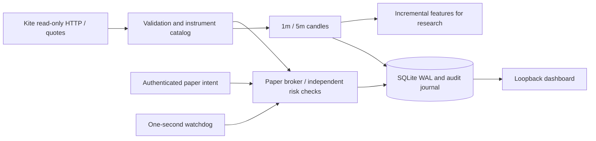

# Architecture and invariants

Version 0.10.0 introduces `api/setup.py` for the manual service's browser setup and
feed lifecycle. It owns private broker credentials and a replaceable `QuoteStream`,
while the same `PaperBroker`/database owner continues to enforce every financial
gate. Broker profile/login/catalog I/O runs outside the quote/risk lock; setup HTTP
actions run in the worker thread pool. Short catalog, configuration and calendar
updates serialize with the engine. Setup is not on the quote analysis hot path and
its status fetch resolves at most ten selected rows, rather than serializing the
full imported catalog. The supervised `PaperService` remains a distinct bound flow.

UI session credentials are persisted as a private atomic JSON file beside the
database, overriding environment broker values for the manual service only. A
reviewed calendar is committed as a new private snapshot before the selected TOML
points to it. This preserves the previous referenced calendar on configuration
failure; an orphan snapshot may remain. No economic setting, balance, position or
used date definition can be rewritten by the Setup API. See
[ui-setup.md](ui-setup.md) and [API contracts](api-contracts.md).

The application is a Python 3.13 modular monolith. `main.py` owns startup, CLI and
shutdown. HTTP/WebSocket market data flows through `broker/readonly_kite.py`, typed
models, the paper risk/execution boundary and SQLite. Stream candles are persisted
separately after quote processing. Candle-write failure latches a fault and disconnects
the feed. The default service accepts operator intents. Phase 4 additionally binds
a dedicated account to explicitly configured rules/model and supervised entry controls.
Phases 2–3 retain isolated offline research.

## Trust and time

Execution has no reference to a network broker client. The HTTP transport maps
explicit route/method pairs to fixed Kite HTTPS URLs. Its sole permitted POST is
manual authentication at `/session/token`. The WebSocket worker sends only subscribe
and full-mode messages. TLS verification is enabled; environment HTTP proxies and
HTTP redirects are disabled. The official order-capable SDK is not installed.

Public timestamps require an explicit timezone, normalize to UTC, and serialize with
microseconds. NSE full-mode epoch timestamps are decoded directly in UTC, independent
of host timezone. Session decisions convert to Asia/Kolkata. No weekday-only holiday
heuristic exists; a reviewed date allowlist is required. Replay injects every clock.

## Ownership, transactions and recovery

A nonblocking `flock` locks the account for its owning process. One Uvicorn worker
is supported. Inside that process an `RLock` serializes feed, watchdog and API access,
and SQLite uses `BEGIN IMMEDIATE`, WAL, foreign keys and `synchronous=FULL`. A paper
fill, position/cash update, fees, order state and audit events share one transaction.
An I/O failure rolls the transaction back and latches an in-memory fault; the process
requires verified restart. A durable kill is stored separately and survives restart.

Schema version 1 creates metadata, instruments, latest quotes, candles, orders,
fills, positions and ordered journal events. Candidate/risk records are journal
events rather than duplicate tables. Orders materialize cash/risk reservations;
positions materialize cost basis. Account snapshots are derived transactionally
from these records. Unknown schema versions and missing required metadata fail closed.
Later migrations must be explicit and preserve the fill ledger; there is no destructive
automatic migration or balance reset.

Startup reconstructs cash, quantity, cost basis, fees and realized P&L from fills and
compares them to the materialized account. It validates order fill totals, turnover,
fees and reservations before accepting work. Pending orders are conservatively
cancelled on startup, then required exits are re-created after reconciliation.
Exit identities include a durable journal sequence, so cancelling and reissuing an
exit at the same timestamp cannot collide or duplicate a fill.
This intentionally strengthens the plan's ambiguous instruction to recover pending
orders: a restarted process never silently continues an old entry decision.
Risk-policy hash mismatches require a separate account. Broker connectivity and
quote trust are never restored from disk.

## Data and performance

Instrument mapping uses `NSE:symbol` identity plus unique token and tick size.
Conflicting remaps are rejected. Quotes validate depth, tick grid, positivity,
timestamp order, cumulative volume and age. Repeated identical quotes have no effect;
conflicting same-time or out-of-order quotes block the symbol until a valid later one.
The packet timestamp has second resolution, so multiple changed packets in the same
second are conservatively rejected. This trades some data completeness for safety;
it is unsuitable for tick-level strategy research.

Builders retain one active candle and prior quote per instrument/timeframe. They do
not emit an active candle until the next interval/watermark. Initial volume is unknown;
missing intervals are flagged. Volume deltas across boundary ticks are assigned to
the new bucket; exact exchange OHLCV should use verified historical candles. A stream
disconnect clears builders, preventing outage-spanning candles from looking complete.
Indicators reject incomplete/flagged/gapped input, use session-local VWAP, EMA and
Wilder ATR, and reset on the next local date. Supervised feed signals use completed
historical bars in Phase 4; optional models add an independent execution gate.

Journal growth is linear in accepted quote events. Current records have indexed
lookups and at most ten streaming instruments and two held positions by default.
Reconciliation scans fills on startup, not on each tick. See [performance.md](performance.md).

## Phase 2 isolated research

`strategy/rules.py` maintains one bounded state per symbol: completed-candle
indicators, a prior-volume deque/sum, fixed opening range and per-session candidate
count. Hypothesis settings are immutable and hashed. Rule code has no broker client
or execution reference; it returns a candidate and explanatory feature/filter record.
All accepted candidates still pass the same independent transactional risk engine.

`backtesting/dataset.py` validates a raw-price manifest and bounded chronological
JSONL stream. Candle availability cannot precede its close; quote availability
cannot precede exchange/receipt time. Source files are hashed before processing and
verified afterward. Candidate injection, unknown symbols/tokens/dates and external
bundle paths are rejected. The input reader does not create an OHLC execution path.

`backtesting/runner.py` injects event time into an isolated paper account, journals
strategy evaluations, submits candidates and writes observations incrementally.
No service-account engine, broker API or wall-clock strategy timing is used. The
report records runtime, rule/config/policy/code/input/journal identities. Net trade
statistics derive from the fill ledger and combine partial exits until a position
is flat. Open positions are preserved and make results incomplete.

`backtesting/export.py` opens source storage without invoking `PaperBroker`, avoiding
restart cancellation. It merges quote journal and completed candles into a new
bundle, retains calendar provenance and labels replay/mixed origins synthetic.
An external verified candle file can replace research candle inputs without changing
the source ledger. Manifests are written last, so failed exports are not loadable.
The offline exporter may sort/scan substantial data; it is not run on the feed path.

`main.py` exposes separate research commands. Default services retain operator
intents; dedicated supervised services are described below. No existing economic
policy-hash encoding changed.

## Phase 3 labels, fitting and inference

`ml/labeling.py` streams causal candidates into bounded independent paper trials.
Each uses real sizing/fill/fee code and later quotes; interrupted, unfilled or
unresolved outcomes are censored. Its deadline is known at entry and queues an exit
before reading later prices. Audit records precede temporary-account cleanup. The
source, settings, code, sample file and audit are preserved in a completion manifest.

`ml/splits.py` groups whole IST sessions in expanding windows and purges label
intervals across calibration/evaluation boundaries with a time embargo. Offline
`ml/training.py` fits train-only scaling/logistic coefficients and a later independent
sigmoid calibrator. Final coefficients freeze before final holdout metrics are
computed. Diagnostics and gates are stored with the model; availability follows the
latest validation label, session close or source observation plus embargo, protecting
later replay from approval leakage.

`ml/inference.py` loads bounded, hash-verified JSON coefficients and performs pure
Python math. `ml/validation.py` checks report identities, windows, calibration bins,
metric gates and availability without importing training dependencies. Candidate
fingerprints bind features to economic intent. Artifacts never execute pickle or
joblib. A failed gate rejects loading; synthetic overrides only relax provenance.

The scored runner buffers candidates at one availability timestamp, scores/sorts
with deterministic tie breaks and submits before the next timestamp. `PaperBroker`
checks model identity, feature context, cutoff and threshold independently, then
applies the existing risk/sizing/reservation boundary. Model IDs persist in metadata
so a restart cannot remove that account's gate. Rule-only runs retain their original
immediate submission behavior. Model decisions, vectors and scores are auditable.

No new database schema or live endpoint is needed. The shared policy fingerprint
preserves the original economic hash encoding. Heavy dependencies are optional
training extras; connected runtime imports no training code. See [ml-research.md](ml-research.md).

## Phase 4 supervised feed pipeline

`paper/runtime.py` serializes quote processing, history evaluation, supervision and
watchdog actions using the existing engine lock. It starts disarmed, warms from
current-session history with `ENTRIES_DISABLED`, requires every reviewed symbol to
be ready, then ranks one observed candle batch before independent risk admission.
Missing/stale/invalid input disarms and cancels pending buys. Stale holdings or
disconnects queue durable kill exits; later valid quotes still supply fills.

`paper/service.py` isolates paced history HTTP from the quote callback and execution
lock. Full current-session five-minute responses are validated before evaluation.
The last-completed boundary and connection generation reject incomplete or obsolete
work. Active stream bars are not mixed into authoritative signal history. Protective
execution continues while history waits. Monotonic request spacing respects the
configured broker budget; late candle signals are skipped instead of backdated.

Dedicated metadata binds runtime/rule version, complete strategy/feed policy, catalog,
model and synthetic mode. Used session definitions are pinned by date. The broker
checks automation identity before restart cancellation and requires the controller
on new submissions. Manual startup or changed policy cannot remove the gate.
`paper-init` binds a new account without assigning a conflicting manual model identity.
Proposal caps derive from durable indexed events, including rejected proposals.

Bounded timing rings retain 512 observations per stage plus cumulative counts/maxima/
budget exceedances. Periodic telemetry journals capture timings and observed per-run
equity/drawdown; missing crash samples are disclosed. `paper/report.py` reads storage
without broker recovery and derives net trades, incidents and preliminary gates.
It cannot attest real hardware or enable live execution.

Schema v1 gains the compatible additive `events_kind_time` index, preventing proposal
lookups from scanning quote history. It changes no ledger or economic-policy hash.
See [paper-feed.md](paper-feed.md) for operations and measurement limits.
Supervised source export also preserves first candle observation clocks and recorded
connection changes. Delayed bars sort by actual availability, missing clocks fail,
and unclocked external overrides are refused; manual-source close assumptions remain
explicitly separate.

## Responsive supervision and local diagnostics (0.4.1)

The UI is plain packaged HTML/CSS/JavaScript under `api/static`, with no Node build,
external asset fetch, browser token persistence or client financial calculations.
`api/console.py` captures a combined account/orders/quote/automation view under the
engine lock; separate transactions for automation status avoid nesting. The orders
query uses reverse rowid traversal with a 201-row bound and returns at most 200;
quotes are bounded at ten. Existing full-history API behavior remains unchanged.
UI polling performs no recovery, arming, journal write or integrity scan. Transport
staleness is visible and blocks entry-enabling UI controls while the independent
server watchdog remains responsible for actual risk handling.

`observability/preflight.py` is a separate on-demand read path. It opens the existing
account with SQLite `mode=ro`, query-only and ordinary WAL locks, takes a coherent
read transaction and reuses the SELECT-only ledger reconciliation routine. It does
not instantiate the owning Database/PaperBroker. A progress deadline bounds normal
SQL work; raw failure details/secrets are not emitted. Local environment/storage/
identity checks and private evidence are distinct from unverified external broker/
device acceptance. See [acceptance.md](acceptance.md) and
[operator-console.md](operator-console.md).

## Long-term composition and reconstruction (LT1)

`Settings.investment_horizon` selects intraday or a separate long-term paper policy.
The shared broker retains atomic reservations, adverse quote/depth fills and Decimal
cash/cost accounting. `execution/long_term.py` composes overnight day-roll/watch,
review/quarantine, durable exit intent, delivery DP allocation and observed portfolio
checkpoints. It replaces session liquidation only for the bound long-term horizon.
Intraday economic hash encoding and defaults remain unchanged. Existing intraday
strategy/model automation is explicitly rejected on long-term accounts.

`execution/delivery.py` defines strict holding review/exit contracts and startup
reconstruction of delivery fees/day allocations and ordered review/fill/exit evidence.
Financial effects remain in the existing fill ledger; compatible metadata/journal
categories add horizon/schema, reviews, quarantine, exit intents and equity checkpoints.
No destructive schema migration or silent account conversion exists. Normal SQLite
WAL/FULL durability, ownership and rollback remain. Review blocking precedes raw quote
replacement, and new-day reference capture precedes opening-price acceptance.

The private API/console adds horizon-specific review and individual-exit controls.
`long-term-report` reads a stopped source account without constructing an execution
engine; `long-term-demo` owns independent invented accounts. Heavy reconstruction and
report scans stay off the quote path. See [long-term.md](long-term.md) for supported
scope and the reviewed cash/share adjustment, pending daily strategy and real custody layers.

## LT2 financial-event reconstruction

`corporate_actions/contracts.py` validates bounded explicit input;
`service.py` performs exclusive offline batch/receipt transactions and calendar/
price-basis checks. `accounting.py` derives entitlements and reconstructs economics
in ordered financial-journal sequence using fills plus the new additive
`corporate_batches`/`corporate_payments` tables. SQLite schema version 1 is retained;
legacy accounts need no financial migration or policy-hash change. An account with
LT2 evidence requires this release or later, and missing schema/table/event evidence
fails closed. Original orders/fills are retained, including their original units.

Materialized claims/basis boundaries/income and two constant-size unpaid-claim caches
are updated atomically with positions/cash/order cancellation and journal. Startup,
read-only preflight and reports independently verify them. Heavy history replay and
input review stay off the quote path. Polling reads the receivable/unknown-count
caches by primary key. Split/bonus claims partition cost; dividend receivables are
nonspendable; net receipts transfer or realize claims once. `ledger_results` follows
share actions when deriving whole-holding capital metrics and separately discloses
fraction basis; investment income remains outside trade metrics.

`execution/delivery.py` reconstructs quarantine resolutions alongside reviews/fills.
`LongTermBook` rejects unchanged pre-application quotes, requires a new clear review,
includes known receivables in equity and treats unknown fractions as stale. It pins
used action sessions before restart cancellation and retains holding exit identity.
See [corporate-actions.md](corporate-actions.md) for operational and modeling limits.

## LT3a research boundary and dashboard (0.7.0)

`daily_research/dataset.py` validates bounded manifest/streaming JSONL, historical
membership clocks, raw OHLC and explicit period-benefit/price-basis availability.
`analysis.py` uses bounded deques/rolling sums per symbol and binary-search membership
lookup. It resets gaps/re-entry, ranks only qualifying complete observations and
retains missing/excluded states. Analysis is outside the connected feed and never
constructs Database/PaperBroker. Source mutation checks precede a final evidence
manifest. Python code hashes identify logic; artifact hashes include the generated UI.

`dashboard.py` packages local HTML/CSS/JS into a self-contained report with hash CSP,
escaped JSON and text-only rendering. It exposes filter/sort/clear, provenance,
metric definitions, actionable incomplete states and keyboard/mobile layout. No
network or live-control surface is present. The analytical gross total-return index
assumes same-close reinvestment; it is not paper account accounting or execution.
See [daily-research.md](daily-research.md).

## LT3b offline daily execution and model boundary (0.8.0)

`daily_execution` owns separate strict execution contracts, availability-driven
`DailyTimeline`, strategy, quote/action routing, independent label accounts and
JSON daily model validation/loading. `runner` creates a new dedicated delivery
account and reuses `PaperBroker`, LT2 ledger and independent database reconciliation.
It never acquires the configured service account. Equal-clock controls/quotes finish
before fresh proposals rank; different-clock proposals never reorder retrospectively.
Daily windows advance once; selected symbols and active trials are bounded. Sourced
execution calendars retain corporate-action authority, and future daily ranges/
benefits are consistency refusals only, never execution/features.

Shared ML coefficient/split/fit/diagnostic algorithms use structural types without
sharing feature/model namespace or enabling connected long-term inference. Model
availability includes final evidence/declared close plus embargo. Failure leaves no
finished manifest. Self-contained CSP-bound dashboards explain portfolio, label and
validation meanings. Detailed contracts and workflow: [daily-execution.md](daily-execution.md).

## LT3c1 contribution and SIP foundation (0.9.0)

`portfolio/contracts` defines immutable cash-budget requests, approvals and explicit
SIP sessions. `service.prepare` is a read-only exact account/quote-context proposal;
confirmation revalidates under the engine lock and writes proof/order/reservations
in one writer transaction. Shared broker sizing subtracts held value from position
room; fill processing retains protection/opening identity and rechecks capacity.
Plan cancellation atomically cancels pending plan buys without closing filled shares.

Additive `portfolio_requests` / `sip_plans`, unique plan/date and journal/schema
support SELECT-only authority reconstruction in `Ledger`. It verifies preview/order
identity, first-fill basis, later quote authority/cap and existing accounting. Original
purchase history is derived from filled BUY orders, distinct from current pooled
holdings. New UI/API share exact money formatting, bearer/origin and stale/lock gates.
No scheduler, network client, external funding or cross-account allocator is added.
See [portfolio-contributions.md](portfolio-contributions.md).
