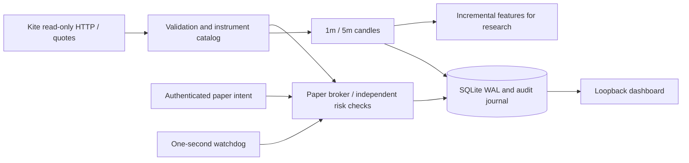

# Architecture and invariants

The application is a Python 3.13 modular monolith. `main.py` owns startup, CLI and
shutdown. HTTP/WebSocket market data flows through `broker/readonly_kite.py`, typed
models, the paper risk/execution boundary and SQLite. Stream candles are persisted
separately after quote processing. Candle-write failure latches a fault and disconnects
the feed. The connected service's strategy is operator supplied; ML explicitly raises
`ModelUnavailable`. Phase 2 rules use these indicators in offline research.

## Trust and time

Execution has no reference to a network broker client. The HTTP transport maps
explicit route/method pairs to fixed Kite HTTPS URLs. Its sole permitted POST is
manual authentication at `/session/token`. The WebSocket worker sends only subscribe
and full-mode messages. TLS verification is enabled; environment HTTP proxies and
HTTP redirects are disabled. The official order-capable SDK is not installed.

Public timestamps require an explicit timezone, normalize to UTC, and serialize with
microseconds. NSE full-mode epoch timestamps are decoded directly in UTC, independent
of host timezone. Session decisions convert to Asia/Kolkata. No weekday-only holiday
heuristic exists; a reviewed date allowlist is required. Replay injects every clock.

## Ownership, transactions and recovery

A nonblocking `flock` locks the account for its owning process. One Uvicorn worker
is supported. Inside that process an `RLock` serializes feed, watchdog and API access,
and SQLite uses `BEGIN IMMEDIATE`, WAL, foreign keys and `synchronous=FULL`. A paper
fill, position/cash update, fees, order state and audit events share one transaction.
An I/O failure rolls the transaction back and latches an in-memory fault; the process
requires verified restart. A durable kill is stored separately and survives restart.

Schema version 1 creates metadata, instruments, latest quotes, candles, orders,
fills, positions and ordered journal events. Candidate/risk records are journal
events rather than duplicate tables. Orders materialize cash/risk reservations;
positions materialize cost basis. Account snapshots are derived transactionally
from these records. Unknown schema versions and missing required metadata fail closed.
Later migrations must be explicit and preserve the fill ledger; there is no destructive
automatic migration or balance reset.

Startup reconstructs cash, quantity, cost basis, fees and realized P&L from fills and
compares them to the materialized account. It validates order fill totals, turnover,
fees and reservations before accepting work. Pending orders are conservatively
cancelled on startup, then required exits are re-created after reconciliation.
Exit identities include a durable journal sequence, so cancelling and reissuing an
exit at the same timestamp cannot collide or duplicate a fill.
This intentionally strengthens the plan's ambiguous instruction to recover pending
orders: a restarted process never silently continues an old entry decision.
Risk-policy hash mismatches require a separate account. Broker connectivity and
quote trust are never restored from disk.

## Data and performance

Instrument mapping uses `NSE:symbol` identity plus unique token and tick size.
Conflicting remaps are rejected. Quotes validate depth, tick grid, positivity,
timestamp order, cumulative volume and age. Repeated identical quotes have no effect;
conflicting same-time or out-of-order quotes block the symbol until a valid later one.
The packet timestamp has second resolution, so multiple changed packets in the same
second are conservatively rejected. This trades some data completeness for safety;
it is unsuitable for tick-level strategy research.

Builders retain one active candle and prior quote per instrument/timeframe. They do
not emit an active candle until the next interval/watermark. Initial volume is unknown;
missing intervals are flagged. Volume deltas across boundary ticks are assigned to
the new bucket; exact exchange OHLCV should use verified historical candles. A stream
disconnect clears builders, preventing outage-spanning candles from looking complete.
Indicators reject incomplete/flagged/gapped input, use session-local VWAP, EMA and
Wilder ATR, and reset on the next local date. Models and automated signals do not run
on the execution path in this release.

Journal growth is linear in accepted quote events. Current records have indexed
lookups and at most ten streaming instruments and two held positions by default.
Reconciliation scans fills on startup, not on each tick. See [performance.md](performance.md).

## Phase 2 isolated research

`strategy/rules.py` maintains one bounded state per symbol: completed-candle
indicators, a prior-volume deque/sum, fixed opening range and per-session candidate
count. Hypothesis settings are immutable and hashed. Rule code has no broker client
or execution reference; it returns a candidate and explanatory feature/filter record.
All accepted candidates still pass the same independent transactional risk engine.

`backtesting/dataset.py` validates a raw-price manifest and bounded chronological
JSONL stream. Candle availability cannot precede its close; quote availability
cannot precede exchange/receipt time. Source files are hashed before processing and
verified afterward. Candidate injection, unknown symbols/tokens/dates and external
bundle paths are rejected. The input reader does not create an OHLC execution path.

`backtesting/runner.py` injects event time into an isolated paper account, journals
strategy evaluations, submits candidates and writes observations incrementally.
No service-account engine, broker API or wall-clock strategy timing is used. The
report records runtime, rule/config/policy/code/input/journal identities. Net trade
statistics derive from the fill ledger and combine partial exits until a position
is flat. Open positions are preserved and make results incomplete.

`backtesting/export.py` opens source storage without invoking `PaperBroker`, avoiding
restart cancellation. It merges quote journal and completed candles into a new
bundle, retains calendar provenance and labels replay/mixed origins synthetic.
An external verified candle file can replace research candle inputs without changing
the source ledger. Manifests are written last, so failed exports are not loadable.
The offline exporter may sort/scan substantial data; it is not run on the feed path.

`main.py` exposes separate research commands. The connected service still requires
operator intents; automatic rule execution on the feed is deferred to paper-feed
validation. No schema migration or existing policy-hash change was needed.
