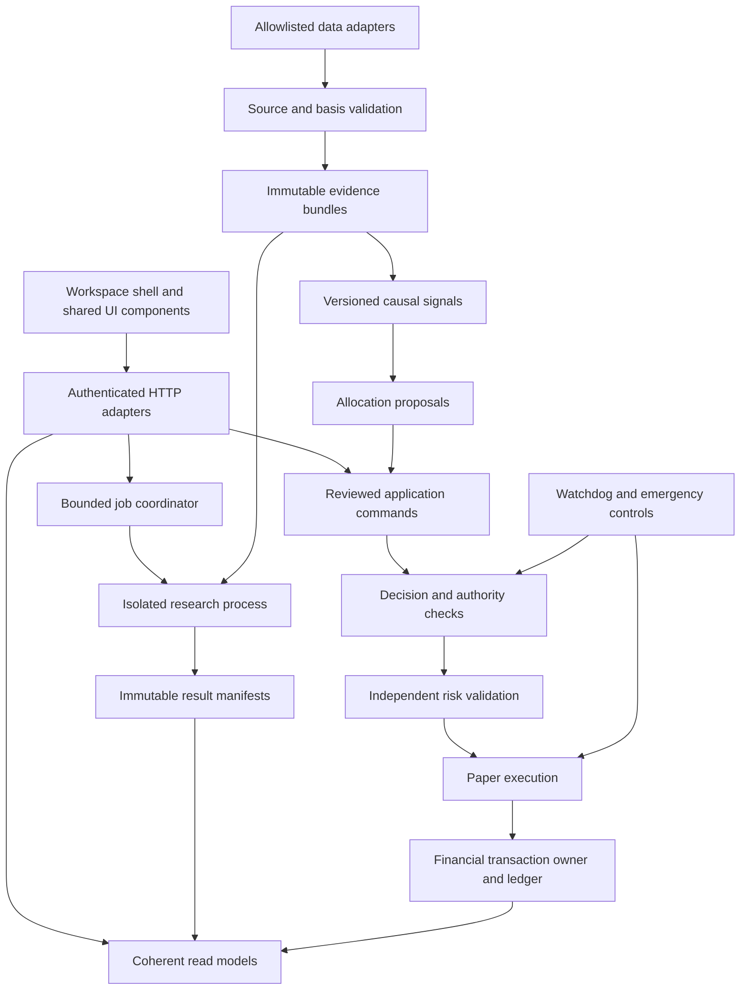

# Phase 2 architecture specification

Date: 22 October 2026 IST. Status: **proposed implementation contract; no application
change in Phase 2**. User approval covers architecture and UX design, not Phases 3–6,
broker activity or alteration of the running account. Read with the
[Phase 1 architecture audit](../ARCHITECTURE_AUDIT.md),
[target API contracts](api-contracts.md),
[financial definitions](financial-metrics.md) and
[strategy/data semantics](strategy-and-data-contracts.md).

## Decisions and preserved boundaries

| ID | Decision | Reason and implementation consequence |
|---|---|---|
| ARCH-01 | Retain Python/FastAPI/Pydantic, SQLite/Decimal, self-hosted HTML/CSS/JavaScript and one owning service process. | Working execution, accounting, authentication, CLI and research remain reusable. No new framework, database server, queue service or network deployment is justified by the audit. |
| ARCH-02 | Keep the same-origin iframe shell during incremental screen work. | Existing credential handoff, lock clearing, navigation guards and standalone entry routes survive. A future frame removal needs a separate design and acceptance gate. |
| ARCH-03 | Keep one financial writer and independent server-side risk validation. | Proposals, previews, paper orders, fills and holdings retain separate authority. Research and display code cannot write financial tables or broker orders. |
| ARCH-04 | Add coherent read models and isolated bounded research jobs around existing engines. | Heavy research must not hold the financial engine lock, reuse the operator account or receive credentials. Query failure and execution integrity failure have different recovery paths. |
| ARCH-05 | Make data, strategy, costs and methodology immutable versioned identities. | A new chart, policy, horizon, source correction or return method cannot silently reinterpret a past report or currently bound account. |
| ARCH-06 | Extend APIs additively; preserve existing route and financial semantics. | The proposed twelve destinations are UI routes, not twelve services. New research/job resources use namespaces; an incompatible response needs an explicit schema/versioned resource, rather than replacing every endpoint with `/api/v2`. |

This design introduces no live execution adapter, live-mode toggle, automatic basis
attestation, cancelled-signal replay, new intraday feature or automatic strategy activation.
The existing pilot seed of ₹25,000 is a configuration baseline, not authority to create
or reset an account. Separate research accounts do not share that capital implicitly.

## Target composition and dependency direction

Arrows represent permitted dependency/call direction, not an instruction for a GET
request to trigger this whole pipeline. A screening result is research evidence; it
becomes neither a decision nor an order by being rendered or saved.

| Component | Existing foundation | Target responsibility and hard boundary |
|---|---|---|
| Composition/transport | `api/app.py`, `desk/api.py`, `api/setup.py`, `api/analysis.py` | Construct services, authenticate, validate bounded input, serialize typed responses. Do not calculate financial amounts or select filesystem paths from requests. |
| UI shell and components | `workspace.js`, `workspace-bridge.js`, `money.js`, page controllers | Fixed routes, unlock/lock, scoped navigation, shared dialogs/status/table/chart shell. Hold bearer token only in memory; financial arithmetic comes from server amounts. |
| Read models | `console_snapshot`, desk/activity/portfolio/analysis views | Acquire one coherent account snapshot; join provenance and explain state. Pure chart/report reads must not call `poll`, `tick`, recovery constructors or financial mutations. Existing mixed view methods need characterization before separation. |
| Data acquisition | `broker/readonly_kite.py`, `desk/sources.py`, `Preparation` | Restrict origin/method/path, stream bounded responses, classify safe failures, persist source evidence. Broker access remains authentication/market reads only. |
| Evidence store/validation | `daily_research/dataset.py`, daily execution contracts, saved bundles | Resolve opaque server-owned IDs; verify file types, hashes, schema, clocks, basis and source coverage. Reject symlinks/path escape, changed inputs and incompatible versions. |
| Research and strategy | `daily_research/`, `daily_execution/`, `desk/signals.py`, `ml/` | Deterministic computations with event/availability clocks and declared parity identity. Pure results have no submission callback, credentials or financial-table write handle. |
| Portfolio construction | Existing sizing/risk plus proposed allocation planner | Produce targets and cost/risk explanations; include pending exposure and unknown sector states. A target is not a cash reservation or authorization. |
| Decision/application commands | `desk/service.py`, `desk/guided.py`, portfolio service | Bind operator review, revision, exact inputs and durable idempotency; orchestrate explicit steps. Preserve no-replay and recovery rules. |
| Risk/execution | `risk/`, `execution/paper_broker.py`, delivery/long-term books | Recheck cash, basis/session/quote/liquidity/policy/kill/duplicates independently at submission and execution. Authoritative prices and quantities stay Decimal/integer. |
| Financial persistence | `persistence/database.py`, accounting/reconciliation modules | One transactional owner for orders, fills, reservations, cash, fees, holdings, claims and audit linkage. Reconstruct authority independently before accepting recovered state. |
| Jobs/artifact registry | Preparation/CLI isolated output patterns, proposed coordinator | Queue/admit/cancel work; publish only verified complete manifests. A worker can write its own scratch account and results, never the operator database or active profile pointer. |
| System administration | Existing settings, backup/verification CLI, proposed read-only status | Report non-secret configuration/schema/storage versions and incidents. Policy edits require a separate reviewed workflow; diagnostics never instantiate a recovering account. |

Extract responsibilities incrementally behind adapters. These rows do not require
renaming directories or splitting the monolith before behavior is covered. Add import
boundary tests: no research/UI/query module imports a real-order transport; the isolated
worker has no operator secret/configuration object or writable account handle.

## Process, concurrency and storage contract

The service remains one Uvicorn worker and one financial engine/database owner. Maintain
the existing Setup → engine lock order; code must not invert it. Record lock ownership
and transaction boundaries before extracting services. Never await broker/network I/O,
rehash a large bundle, render a report or wait for a worker while holding the engine
lock. A command captures a short-lived revision under lock, performs independent work
outside it, then reacquires the lock and revalidates before committing.

Financial transaction scope includes the relevant authority record, order/reservation,
fill, cash/fees/basis/remaining quantity and journal event. SQLite transaction rollback
must leave no half-financial outcome. Filesystem/network steps cannot be described as
one SQLite transaction: guided workflows retain a durable phase record, explicit
partial outcome and recovery plan. Memory authority is revoked before optional error
diagnostics. Restart never replays unfinished approvals or restores an active mode.

New read-only reporting connections use SQLite `mode=ro`/query-only with normal WAL
locking, a bounded read transaction and deadline. A view must not open `PaperBroker`
or call startup recovery. Snapshot metadata records the captured account identity,
ledger sequence and valuation time; independently fetched cards are not claimed to
represent one financial instant. Immutable bundle caches are keyed by full verified
identity; changing a path or modification time is not sufficient evidence of validity.

Research executes in a disposable child process with a separate scratch directory and
database. Data acquisition remains a credential-owning application adapter; admitted
research workers receive only validated local immutable inputs and a minimal environment.
Do not pass broker secrets to workers. No automatic network fetch from a chart or report.
Resource limits, queue states and restart behavior are specified in
[API/job contracts](api-contracts.md#bounded-jobs-and-artifact-integrity).

## Navigation and compatibility contract

The target public shell remains `/workspace`. Fragments are fixed destinations and
optional bounded element IDs, never arbitrary URLs or paths. These twelve destinations
are proposed; adding a menu label is not feature acceptance.

| Group | Canonical target | Existing section reused first |
|---|---|---|
| Overview | `#dashboard` | `/desk` portfolio/next-action overview |
| Research | `#discovery` | Existing reviewed discovery/shortlist content |
| Research | `#analysis` | `/analysis` saved-history screen |
| Plan & simulate | `#strategies` | `/strategies` preparation and policy review |
| Plan & simulate | `#backtesting` | New browser wrapper around valid isolated CLI workflows |
| Plan & simulate | `#paper` | Proposals/order journey; existing desk/activity data |
| My investments | `#portfolio` | Portfolio overview with `#portfolio/purchases` preserving Purchases & SIP |
| My investments | `#history` | `/activity` orders/fills/proposals with clear entity filters |
| Controls | `#risk` | `/console` financial controls only |
| Controls | `#broker` | `/setup` credential/session/catalog/feed workflow |
| Controls | `#settings` | Non-secret current settings/admin, separated from Risk |
| Help | `#learn` | Existing guide/help plus contextual education |

Compatibility resolution occurs before mounting: old `#desk` → `#dashboard`, `#activity`
→ `#history`, `#console` → `#risk`, `#setup` → `#broker`, guide/help → `#learn`.
`#strategies`, `#analysis` and portfolio purchase controls retain their meaning.
The standalone `/portfolio` entry opens `#portfolio/purchases`; its original purchase,
preview and SIP actions remain reachable. Existing `#view/anchor` deep links translate
the view and retain the approved anchor. In particular `apply-shortlist` resolves to
the containing `execution-shortlist` section, not a disabled button. A compatibility
anchor registry must map moved review/feed/policy anchors to their owning screen.
Unknown fragments return a neutral not-found/help state without financial requests.

Keep standalone legacy paths working and no-store; only the explicit section allowlist
can be framed by the same origin. Preserve browser Back/Forward, deep link reveal/focus,
pending-confirmation guards, repeated link activation, and no scroll jumps on polling.
Navigation and unlock do not install, attest, connect, arm or approve anything.

## Shared confirmation and failure contracts

One shared dialog lifecycle replaces page-specific variants incrementally. The active
child owns its confirmation and action. A validated parent/child bridge supplies only
active-frame viewport geometry and dialog-active state; it never conveys approval or
secrets. The dialog must intersect the visible parent content viewport below sticky
chrome, not the full tall iframe. Position before focus; react to parent/frame scroll,
resize, zoom and visual-keyboard viewport changes. Long content scrolls inside a bounded
dialog while heading/actions remain reachable. The shell blocks background navigation
while a child modal is active; child content outside the modal is inert. Cleanup removes
listeners/inert state, restores focus to a live trigger and cancels pending UI authority.
Cross-origin, inactive-frame and unknown message types are ignored.

Cancel/Escape/close never submit a financial mutation. Confirm is one-shot, remains
pending through uncertain network outcome and cannot silently retry. Server expiry or
revision conflict returns to review. Lock clears private content and invalidates late
responses even if the server-side action has completed; reopening queries the durable
outcome instead of resubmitting. Emergency controls retain their explicit consequence
and existing server restrictions; UI geometry cannot authorize a bypass.

Failure isolation is explicit:

| Failure class | Local result | Financial authority |
|---|---|---|
| Chart/template/optional report unavailable | Affected panel unavailable with incident ID and recovery; do not invent values. | Preserve account state if isolated and financial integrity is known. |
| Source timeout/throttle/expired credentials | Stop or bounded safe read retry, clear session verification when appropriate; show actionable category. | Existing data/quote gates remain; no login/exchange/activation retry. |
| Dataset/artifact mismatch | Quarantine that input/result; retain original evidence and show unavailable. | Block decisions dependent on it; no automatic fallback model/policy. |
| Ledger/authority/reconciliation/storage integrity unknown | Latch existing financial fault, revoke authority and stop entries; sanitized incident. | Fail closed; manual verified recovery, never automatic resume. |
| Unclassified internal exception | Fail closed until classified. | Do not weaken the current catch-all simply because its route is a GET. |

## Fix-first implementation acceptance specifications

These are future tests/gates, not claims that the fixes or tests have run.

| ID | Required behavior and independent evidence |
|---|---|
| FIX-CAL-01 | Preparation across January/December requests explicit source coverage for every needed year; merges by date with source-year/hash/acquired-at evidence. Missing previous-year data returns `CALENDAR_COVERAGE_MISSING`, not inferred weekdays or a truncated successful history. |
| FIX-CAL-02 | Date intervals support year/leap boundaries and reviewed exceptional sessions/holidays. Conflicting duplicate dates fail; matching duplicates retain provenance. Defaults 09:15–15:30 are editable proposals, not verified exchange hours. Historical/source calendar proposals grant no execution session authority without explicit review. |
| FIX-CAL-03 | Independent fixtures at early January, leap day and December/January verify enough completed sessions or an honest insufficient-history result, deterministic hashes, no current-account change, and cancellation. Already-used saved session definitions cannot be rewritten; unused corrections retain the existing explicit conservative gate. |
| FIX-BROKER-01 | Typed credential-free categories distinguish authentication/session, permission/entitlement, throttling, timeout/network, provider outage, invalid payload, mapping/source integrity and unknown failure. Do not infer expiry from every 403 or reveal raw broker errors/URLs. |
| FIX-BROKER-02 | Fixed origin/path/method allowlist and TLS/redirect restrictions remain. Stream response bytes within bounds; only safe reads receive bounded Retry-After-aware retry. Login/token exchange, confirmations and financial commands do not auto-retry. Fixtures verify cancellation, bounds, stale verification clearing and zero secret leakage. |
| FIX-MODAL-01 | Actual Firefox plus an available second engine at 360/768/1440px and 200% zoom: deep-scroll connect confirmation fully visible before focus; long text/mobile keyboard/resize/parent scroll remain usable. Setup/Risk/Purchases/strategy dialogs obey the same contract. |
| FIX-MODAL-02 | Keyboard trap/Escape/focus-return, no background activation, lock/unmount cleanup, cancel sends zero mutations, repeated click sends exactly one confirmed request, uncertain result uses status recovery. Synthetic DOM geometry is separate from browser evidence. |
| FIX-FAULT-01 | Inject isolated chart/report/template failures: no account/mode/quote/journal mutation, useful local error. Inject ledger corruption/write failure/unknown exception: existing fault/revocation remains. Compare independent SQL snapshots, not only HTTP status. |
| FIX-BOUNDARY-01 | Navigation/reload/report/job cancellation cannot create a broker order, approve a proposal, rewrite a basis review, replay a terminal daily identity or change intraday strategy behavior. Preserve existing intraday modules; narrowly reviewed correctness work follows its separate roadmap. |

## Migration and rollout contract

1. Characterize existing endpoint/route/status behavior and record exact ledger, claim,
   order, policy and artifact identities using a disposable copy. Do not use the active
   account as a migration test fixture.
2. Add shared components/read adapters behind the existing screens first. Introduce
   target destinations and aliases gradually; unfinished controls state unavailable.
   Do not present a speculative benchmark, fundamental metric or job as implemented.
3. Introduce a central migration registry before the first new durable schema, with
   monotonic migration ID/checksum, required application version and per-module versions.
   Reconcile the existing independent version authorities; never relabel current schema
   versions without an actual tested migration. Unknown/newer versions refuse writes.
4. For each migration, preflight space/ownership/version, take and verify a consistent
   SQLite backup plus referenced private artifacts, apply transactional DDL/data changes
   where possible, and independently reconcile before publishing a new active manifest.
   File+database migrations use phase records and test every interruption boundary.
5. Preserve journal/order/fill/proposal IDs, financial precision, frozen policy meaning,
   hashes and source claims. Add provenance as unknown when genuinely absent; never
   invent old broker/replay provenance or rewrite raw historical evidence in place.
6. An old application must refuse an incompatible upgraded account. Recovery restores
   a complete verified backup to a separate path; no destructive automatic downgrade.
   Mode remains Manual after verified restart, with explicit operator review for any
   later authority. Target-device power-loss acceptance remains separate from crash tests.

Phase 2 acceptance is review of these contracts and the linked screen/data/financial
definitions. It is not migration, browser, broker, profitability or execution acceptance.
Subsequent implementation must update current component/usage documentation with actual
behavior and attach relevant unit, functional, independent accounting and rendered checks.
